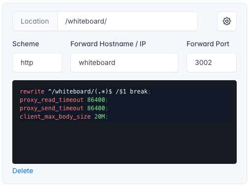

Stack version 3.4

# Nextcloud docker-compose template with MariaDB, Redis, Nextcloud, Nextcloud-cronjobs, Collabora, HaRP, WebSocket server and Talk High-performance backend

This is my Nextcloud Docker-Compose "almost-all-in-one" template.

The stack features separate containers for:
- MariaDB (mariadb:11.5.2)
- redis (redis:alpine)
- nextcloud (nextcloud:35.0.3)
- collabora (collabora/code:latest)
- nextcloud cron jobs (rcdailey/nextcloud-cronjob)
- appapi-harp (ghcr.io/nextcloud/nextcloud-appapi-harp:release)
- WebSocket Server for Real-time Collaboration (ghcr.io/nextcloud/whiteboard:stable)
- Talk High-performance backend (ghcr.io/nextcloud-releases/aio-talk:latest)

The stack also includes dependencies to make sure the DB and Memcache (Redis) are available before the other containers are started.

Configuration for Nextcloud and the DB are mapped from within the docker-compose file (local folder next to the docker-compose.yml file). You can of course change the mount method and path to suit your installation, should you want to access a remote volume for example.

My Home Lab runs Ubuntu Virtual Machines to host my Docker Projects where I run Nginx Proxy Manager as a reverse proxy. You will need to set up a proper domain and/or reverse proxy for Nextcloud to be served over HTTPS. In my Homelab, I use Nginx Proxy Manager as reverse proxy and to issue Let's Encrypt SSL certificates through Cloudflare so I don't have to keep a port open for certbot to call in (a free Cloudflare account totally works which will enable free wildcard certificates for all your local hosts as well).

NOTE:
This docker-compose file doesn't contain the reverse proxy, if you need one, you will have to get it up and running separately. I have a stack that includes Traefik and Traefik Labels for all services, read on if interested.
If you need help setting up Nginx Proxy Manager from Docker to support this stack, let me know!

## Building the nextcloud-custom image

A Dockerfile and build instructions in docker-compose.yml were added to build a custom nextcloud container image so it includes ffmpeg (needed by Recognize and Memories) which is not contained by default in the distributed official image.

The build process is the following:

```bash
docker compose build nextcloud
docker compose up -d
```

You can check if ffmpeg installed correctly once the stack is running with:

```bash
docker exec nextcloud ffmpeg -version
```

## Environment variables

Docker Compose will need environment variables set. I have included an EXAMPLE.env file to make what is expected there easier to understand. Make a copy, edit your secrets and rename the file to .env

If you use Portainer, you will have to set these within Portainer (Advanced mode is easier as you just need to copy-paste the contents of the .env file) when creating the Nextcloud stack after you've pasted the docker-compose.yml file into Portainer. If you use "docker-compose" to bring up the stack, the .env file should be picked up automatically so fill in your information in there.

## Traefik / Nginx Proxy Manager

A reverse proxy is needed to be able to provide all internal services with an SSL certificate and be able to use all services without needing to write port numbers in URLs. I found the easiest for me was to use Cloudflare and get SSL certificates through Cloudflare. A free Cloudflare account is more than enough to achieve this. While you can deploy this Stack without Traefik or Nginx Proxy Manager, you would have to set up SSL certificates for each service individually. Traefik and Nginx Proxy Manager make this otherwise tedious process effortless.

This stack assumes you will be running your own Reverse Proxy (not part of this stack)

I have previously created another stack that uses Traefik, you can check it out here: [https://github.com/Andreaux/Traefik-Docker-Compose-Traefik](https://github.com/Andreaux/Nextcloud-Docker-Compose-Traefik).
Keep in mind, that it is not maintained anymore.

Ideally you would run your reverse proxy from Docker within the same 'proxy' network as this stack runs because it makes addressing the containers much easier using their container names instead of DNS names or IP addresses (e.g. 'http://nextcloud:80').

## WebSocket server for real-time collaboration

The newest addition to the stack is the WebSocket server for real-time collaboration on the Whiteboard. A custom location needs to be set in the Proxy to enable communication between Nextcloud and the Whiteboard server:



```nginx
rewrite ^/whiteboard/(.*)$ /$1 break;
proxy_read_timeout 86400;
proxy_send_timeout 86400;
client_max_body_size 20M;
```

## Talk High-performance backend

The `talk-hpb` service runs the Nextcloud Talk High-performance backend (HPB) using the official Nextcloud AIO Talk image on its own. It bundles the signaling server, the Janus media server, NATS and the eturnal TURN/STUN server in one container. Without it, Talk calls only work well with 2-3 participants.

### Enabling / disabling

The HPB is **optional and disabled by default**. It uses a Docker Compose [profile](https://docs.docker.com/compose/how-tos/profiles/), so you never need to edit `docker-compose.yml` to turn it on or off.

To **enable** it, add this line to your `.env` and redeploy the stack (`docker compose up -d`):

```bash
COMPOSE_PROFILES=talk-hpb
```

To **disable** it again:

1. Remove the High-performance backend, TURN and STUN entries under **Administration settings → Talk**. Otherwise Talk keeps trying to reach a backend that no longer exists and calls will fail.
2. Remove or comment out the `COMPOSE_PROFILES` line in `.env`.
3. Stop and remove the container. Disabling the profile doesn't stop a container that is already running:

```bash
docker compose rm -sf talk-hpb
```

### 1. Secrets

Add the three `TALK_*` secrets to your `.env` (see `EXAMPLE.env`). Generate each one with:

```bash
openssl rand -hex 32
```

### 2. DNS and Nginx Proxy Manager

The HPB needs two hostnames, because signaling goes through NPM while TURN must reach the Docker host directly:

- `signaling.<DOMAINNAME>` → your **NPM** IP, like your other hostnames (HTTPS signaling)
- `turn.<DOMAINNAME>` → the **Docker host** running this stack (TURN/STUN on port 3478). If NPM runs on the same IP as the Docker host, both records point to the same address.

Add a Proxy Host in NPM for `signaling.<DOMAINNAME>`:

- Scheme `http`, Forward Hostname = the Docker host IP, Forward Port `8081`. If port 8081 is already in use on the host, set `TALK_SIGNALING_PORT` in `.env` to a free port and use that port here instead. (If NPM runs in Docker on the `proxy` network, you can use `talk-hpb` with port `8081` instead and remove the port mapping from `docker-compose.yml`.)
- Enable **Websockets Support**
- SSL: use your certificate for the host, Force SSL on

### 3. TURN port

Port `3478` TCP and UDP is published directly on the Docker host and must **not** go through NPM. Make sure nothing else on the host uses port 3478. If your Nextcloud is reachable from the internet, forward 3478 TCP/UDP from your router to the Docker host. For a LAN/VPN-only setup (e.g. Tailscale with a subnet router), nothing needs forwarding.

### 4. Talk settings in Nextcloud

Under **Administration settings → Talk**:

- **STUN servers:** replace the default with `turn.<DOMAINNAME>:3478`
- **TURN servers:** add `turn:` only, server `turn.<DOMAINNAME>:3478`, secret = `TALK_TURN_SECRET`, protocols **UDP and TCP**
- **High-performance backend:** URL `https://signaling.<DOMAINNAME>`, "Validate SSL certificate" on, shared secret = `TALK_SIGNALING_SECRET`

Each section has a test button. The HPB should show as connected with its version. Calls with the HPB rely on the TURN server, so make sure the TURN test passes too.

## Support this project

If you find this useful, a coffee through Ko-Fi is all it takes to make me happy <3 (I love coffee :D) Click the Sponsor button on the top of this page or visit https://ko-fi.com/andreaux to buy me a coffee.

## Disclaimer

This template is provided as-is with no pretention as for its usefulness or accuracy. I provide no support, but am open to comments, suggestions or corrections (please do!). Bear in mind that I'm still learning docker and docker-compose so there's no guarantee I haven't made errors in there although this installation works fine since a few months now.
